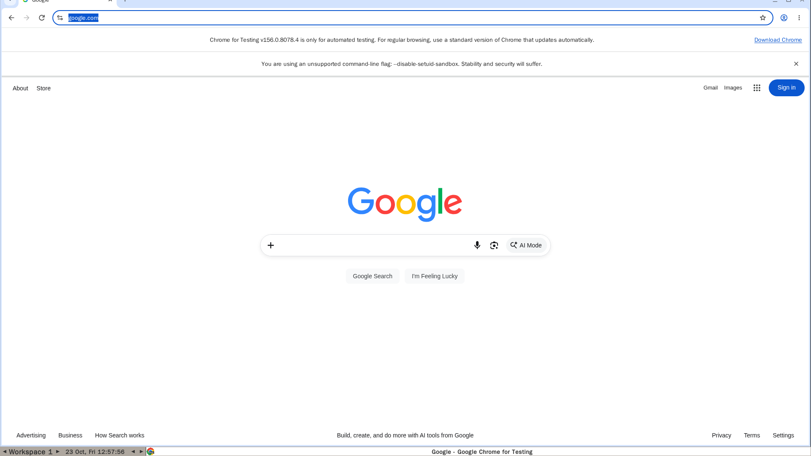
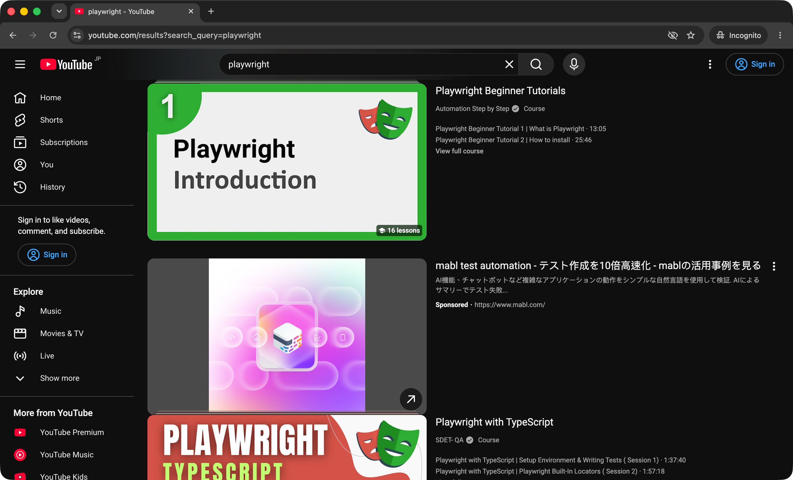

# cdp-browser

[](https://github.com/sideef5ect/cdp-browser/releases)
[](https://github.com/sideef5ect/cdp-browser/actions/workflows/build-image.yaml)
[](https://github.com/sideef5ect/cdp-browser/pkgs/container/cdp-browser)
[](#option-a-docker)
[](LICENSE)

Give a coding agent a real, persistent browser over the Chrome DevTools Protocol (CDP).


The repo has two parts that work together:

- **An agent skill** (`skills/browser/`) that teaches Claude Code, Codex, or any agent that reads `SKILL.md` how to drive a browser through Playwright's `connect_over_cdp()`: fetch text and HTML, take screenshots, fill forms, upload files
- **A browser to drive**, in either of two forms: a Docker image with a headed Chromium on a virtual display, or your own Chrome started with remote debugging on

Both speak the same CDP API: the container on `http://localhost:19222`, host Chrome on its usual `http://localhost:9222`. Separate ports let both run at once, and switching backends only changes the URL.

| Container (`localhost:19222`) | Host Chrome (`localhost:9222`) |
|---|---|
|  |  |

## Quick Start

Install the skill; it carries the setup docs, so the agent starts a browser itself when none is running.

**Claude Code**:

```text
/plugin marketplace add sideef5ect/cdp-browser
/plugin install cdp-browser@cdp-browser
```

**Codex**:

```bash
git clone https://github.com/sideef5ect/cdp-browser
mkdir -p ~/.agents/skills && cp -r cdp-browser/skills/browser ~/.agents/skills/browser
```

Then ask the agent: "Take a screenshot of example.com". Other agents and starting a browser by hand are covered in [Usage](#usage).

## Features

Each item is prefixed with the milestone it belongs to. Checked items are implemented; unchecked items are planned.

- [x] **(v1.0)** Persistent session: one long-lived browser whose cookies and logins survive restarts, so a script connects to it instead of launching a fresh browser each time
- [x] **(v1.0)** Two backends, one API: a Docker container for isolation and servers (`localhost:19222`), or host Chrome when you need your real logins (`localhost:9222`), side by side without port conflicts
- [x] **(v1.0)** No focus stealing: `background_tab()` opens tabs in the background, keeps popups and `target=_blank` links in the same tab, and suppresses "Leave this page?" dialogs, so host Chrome never jumps in front of you
- [x] **(v1.0)** Watch it live: VNC into the container's display to see what the agent is doing, or to log in by hand once
- [x] **(v1.0)** WebKit included, for H.264 video on ARM64 Linux, where Chromium has no proprietary codecs
- [x] **(v1.0)** Pre-built image for `linux/amd64` and `linux/arm64`: pull it from GHCR, no local build needed
- [x] **(v1.0)** Skill installs as a Claude Code plugin, or by copying into Codex (`~/.agents/skills`) or any agent that reads `SKILL.md`
- [ ] **(v1.1)** Container health check on `/json/version`, so `docker ps` and Compose report when CDP is up
- [ ] **(v1.1)** Host Chrome setup for Windows
- [ ] **(v1.2)** Browser viewer in a web page (noVNC), so watching needs no VNC client
- [ ] **(v1.2)** Token-protected CDP endpoint, for running the container on a shared or remote host
- [ ] **(v1.2)** Headless mode switch, to run without Xvfb and VNC where nobody needs to watch

## Usage

### Install the Skill

**Claude Code**, as a plugin from this repo:

```text
/plugin marketplace add sideef5ect/cdp-browser
/plugin install cdp-browser@cdp-browser
```

**Codex**, which reads skills from `~/.agents/skills` (user) or `.agents/skills` (repo):

```bash
git clone https://github.com/sideef5ect/cdp-browser
mkdir -p ~/.agents/skills && cp -r cdp-browser/skills/browser ~/.agents/skills/browser
```

Or ask Codex's built-in `$skill-installer` to install `skills/browser` from `sideef5ect/cdp-browser`.

**Any other agent** that reads `SKILL.md` files: copy `skills/browser/` into its skills folder (for Claude Code without the plugin, `~/.claude/skills/browser`).

The agent then picks the skill up when you ask it to fetch a page, scrape, take a screenshot, or automate a browser task.

### Start a Browser

#### Option A: Docker

Pull the pre-built image (public, no login needed):

```bash
docker pull ghcr.io/sideef5ect/cdp-browser:latest
```

Run it:

```bash
docker run -d \
  -p 127.0.0.1:19222:19222 -p 127.0.0.1:15900:15900 \
  -v browser-chrome-profile:/app/chrome_profile \
  -v browser-webkit-profile:/app/webkit_profile \
  --shm-size=1g \
  --name browser-cdp \
  ghcr.io/sideef5ect/cdp-browser:latest
```

Or with Compose, on the host network so the browser can reach dev servers on `localhost`:

```bash
docker compose -f docker/docker-compose.yaml up -d
```

| Tag | Points to |
|---|---|
| `latest` | Latest release, or the latest manual build of `master` |
| `1.0.0`, `1.0` | GitHub release `v1.0.0` |
| `sha-<commit>` | A specific commit; the 4 most recent are kept |

#### Option B: Host Chrome

Use your installed Chrome when the agent needs your real logins, or you have no Docker. Chrome refuses remote debugging on its default profile, so give it its own `--user-data-dir`. On macOS, `open -g` starts it without bringing it to the front:

```bash
open -g -na "Google Chrome" --args \
  --remote-debugging-port=9222 \
  --user-data-dir="$HOME/.cache/chrome-cdp" \
  --no-first-run --no-default-browser-check \
  --disable-background-timer-throttling \
  --disable-renderer-backgrounding \
  --disable-backgrounding-occluded-windows
```

On Linux, run `google-chrome` with the same flags. Logins made in this window persist in `~/.cache/chrome-cdp`.

### Connect

```bash
curl -s http://localhost:19222/json/version   # container
curl -s http://localhost:9222/json/version    # host Chrome
```

```python
from playwright.sync_api import sync_playwright

with sync_playwright() as p:
    browser = p.chromium.connect_over_cdp("http://localhost:19222")  # host Chrome: 9222
    page = browser.contexts[0].new_page()
    page.goto("https://example.com")
    print(page.title())
```

For anything that may run against host Chrome, use the `background_tab()` helper from [`SKILL.md`](skills/browser/SKILL.md) instead of `new_page()`, so the window stays behind your work.

## Architecture

The diagram at the top shows how the parts connect; this section lists what each part does.

### Components

| Component | Role |
|---|---|
| `skills/browser/SKILL.md` | Usage for the agent: which backend, the ready check, the focus rules, the `background_tab()` helper, recipes, and an index of the setup docs it loads only when needed |
| `background_tab()` | Opens a tab with `Target.createTarget` (`background: true, focus: false`), injects an init script that blocks popups and `beforeunload`, answers dialogs, and closes the tab and any child it opened on exit |
| Xvfb + fluxbox | A 1920x1080 virtual display and window manager, so Chromium runs headed rather than headless, the same as a desktop browser |
| Playwright Chromium | The browser, with remote debugging on internal port 19223 and the profile on a volume |
| socat | Headed Chromium ignores `--remote-debugging-address` and listens on `127.0.0.1` only, which `docker -p` cannot reach. socat forwards `0.0.0.0:19222` to it, making CDP reachable from outside the container |
| x11vnc | Mirrors the virtual display on port 15900 |
| WebKit | Installed alongside for H.264 on ARM64; it has no CDP, so scripts run inside the container with `docker exec` (see [`docs/webkit.md`](skills/browser/docs/webkit.md)) |
| `entrypoint.sh` | Clears stale X and profile locks from an unclean shutdown, starts each process in order, waits for CDP, and stops them all on `SIGTERM` |

### Ports and Volumes

| Port | Service |
|---|---|
| 19222 | CDP (`CDP_PORT`) |
| 15900 | VNC (`VNC_PORT`; password from `VNC_PASSWORD`, default `changeme`) |

| Volume | Purpose |
|---|---|
| `/app/chrome_profile` | Chromium profile: cookies, sessions, cache |
| `/app/webkit_profile` | WebKit persistent context |

> [!WARNING]
> CDP gives full control of the browser, including every logged-in session in its profile, with no authentication. Publish the ports on `127.0.0.1` only. With `--network host` on Linux, ports 19222 and 15900 listen on every interface, so firewall it or use port mapping instead. Change `VNC_PASSWORD` from the default.

## Project Structure

```text
cdp-browser/
├── .claude-plugin/
│   ├── marketplace.json      # lets /plugin marketplace add install from this repo
│   └── plugin.json           # plugin metadata and version
├── .github/
│   ├── workflows/
│   │   ├── build-image.yaml  # on each release tag: multi-arch build, push to GHCR, prune
│   │   └── release.yaml      # release-please: release PR, tag, GitHub release
│   ├── ISSUE_TEMPLATE/       # bug report and feature request forms
│   ├── pull_request_template.md
│   └── dependabot.yml        # weekly updates for actions and the base image
├── docker/
│   ├── Dockerfile            # Ubuntu 22.04 + Playwright Chromium/WebKit + Xvfb/VNC/socat
│   ├── entrypoint.sh         # process startup and shutdown
│   └── docker-compose.yaml   # host-network run of the published image
├── skills/browser/
│   ├── SKILL.md              # the agent skill: usage, focus rules, helper, recipes, docs index
│   ├── docs/
│   │   ├── setup-container.md    # Docker start, ports, volumes, VNC, management
│   │   ├── setup-host-chrome.md  # host Chrome with remote debugging (macOS, Linux)
│   │   └── webkit.md             # WebKit recipes (H.264 on ARM64)
│   └── test/focus_test.py    # macOS focus test for background_tab()
├── scripts/check_playwright_version.py  # pyproject and Dockerfile pin the same Playwright
├── docs/assets/              # README diagrams (SVG + generator) and screenshots
├── CLAUDE.md                 # contributor guide for coding agents
├── CONTRIBUTING.md           # dev setup, tests, commit format
├── SECURITY.md               # how to report a vulnerability privately
├── pyproject.toml            # uv dev environment: Playwright client, ruff
├── uv.lock
├── .python-version           # 3.14
├── release-please-config.json
├── .release-please-manifest.json
├── LICENSE
└── README.md
```

## Development

Build the image locally:

```bash
docker build -t cdp-browser docker/
docker build --build-arg PLAYWRIGHT_VERSION=1.64.1 -t cdp-browser docker/
```

Set up the Python environment with `uv sync`: it uses Python 3.14 from `.python-version` and the Playwright client pinned to the image's version.

Run the focus test on macOS, with host Chrome started as in Option B and another app in front:

```bash
uv run skills/browser/test/focus_test.py
```

It reads the helper straight from `SKILL.md`, so it tests the code the skill tells agents to paste.

Releases are cut by [release-please](https://github.com/googleapis/release-please-action) from Conventional Commits on `master`: it keeps a release PR open that bumps `CHANGELOG.md` and the version in `.claude-plugin/plugin.json`. Merging that PR tags `vX.Y.Z` and creates the GitHub release. The Build Image workflow then runs on its own and publishes the `X.Y.Z`, `X.Y`, and `latest` image tags.

## Contributing

Issues and pull requests are welcome. See [CONTRIBUTING.md](CONTRIBUTING.md) for the dev setup, tests, and commit format, and [SECURITY.md](SECURITY.md) to report a vulnerability privately.
