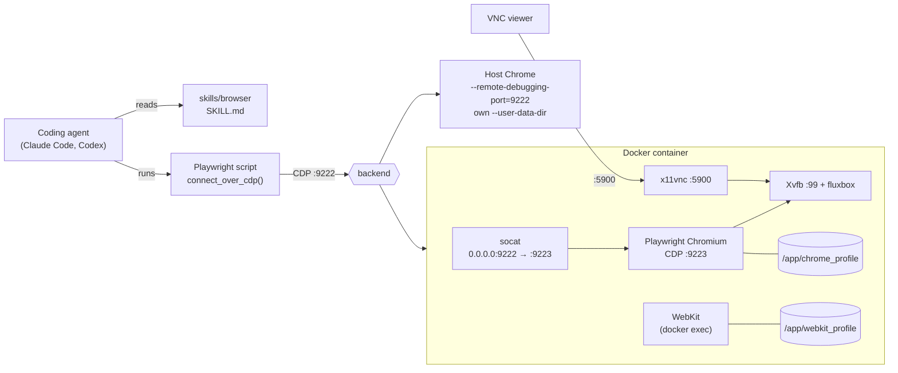

# cdp-browser

Give a coding agent a real, persistent browser over the Chrome DevTools Protocol (CDP).

The repo has two parts that work together:

- **An agent skill** (`skills/browser/`) that teaches Claude Code, Codex, or any agent that reads `SKILL.md` how to drive a browser through Playwright's `connect_over_cdp()`: fetch text and HTML, take screenshots, fill forms, upload files
- **A browser to drive**, in either of two forms: a Docker image with a headed Chromium on a virtual display, or your own Chrome started with remote debugging on

Both expose the same endpoint, `http://localhost:9222`, so the skill and your scripts don't change when you switch between them.

## Features

| Feature | What it means |
|---|---|
| Persistent session | One long-lived browser. Cookies and logins survive restarts, so a script connects to it instead of launching a fresh browser each time |
| Two backends, one URL | Docker container for isolation and servers; host Chrome when you need your real logins |
| No focus stealing | The skill's `background_tab()` helper opens tabs in the background, keeps popups and `target=_blank` links in the same tab, and suppresses "Leave this page?" dialogs, so host Chrome never jumps in front of you while an agent works |
| Watch it live | VNC into the container's display to see what the agent is doing, or to log in by hand once |
| Multi-arch image | `linux/amd64` and `linux/arm64` on GHCR, built by GitHub Actions |
| WebKit included | For H.264 video on ARM64 Linux, where Chromium has no proprietary codecs |
| Tested helper | A macOS focus test runs popups, `window.open()` and `beforeunload` forms against real Chrome and fails if Chrome ever becomes frontmost |

## Usage

### Install the Skill

**Claude Code**, as a plugin from this repo:

```text
/plugin marketplace add sideef5ect/cdp-browser
/plugin install cdp-browser@cdp-browser
```

**Codex**, which reads skills from `~/.agents/skills` (user) or `.agents/skills` (repo):

```bash
git clone https://github.com/sideef5ect/cdp-browser
mkdir -p ~/.agents/skills && cp -r cdp-browser/skills/browser ~/.agents/skills/browser
```

Or ask Codex's built-in `$skill-installer` to install `skills/browser` from `sideef5ect/cdp-browser`.

**Any other agent** that reads `SKILL.md` files: copy `skills/browser/` into its skills folder (for Claude Code without the plugin, `~/.claude/skills/browser`).

The agent then picks the skill up when you ask it to fetch a page, scrape, take a screenshot, or automate a browser task.

### Start a Browser

#### Option A: Docker

Pull the pre-built image (public, no login needed):

```bash
docker pull ghcr.io/sideef5ect/cdp-browser:latest
```

Run it:

```bash
docker run -d \
  -p 127.0.0.1:9222:9222 -p 127.0.0.1:5900:5900 \
  -v browser-chrome-profile:/app/chrome_profile \
  -v browser-webkit-profile:/app/webkit_profile \
  --shm-size=1g \
  --name browser-cdp \
  ghcr.io/sideef5ect/cdp-browser:latest
```

Or with Compose, on the host network so the browser can reach dev servers on `localhost`:

```bash
docker compose up -d
```

| Tag | Points to |
|---|---|
| `latest` | Latest build of `main` |
| `1.0.0`, `1.0` | Release tag `v1.0.0` |
| `sha-<commit>` | A specific commit; the 4 most recent are kept |

#### Option B: Host Chrome

Use your installed Chrome when the agent needs your real logins, or you have no Docker. Chrome refuses remote debugging on its default profile, so give it its own `--user-data-dir`. On macOS, `open -g` starts it without bringing it to the front:

```bash
open -g -na "Google Chrome" --args \
  --remote-debugging-port=9222 \
  --user-data-dir="$HOME/.cache/chrome-cdp" \
  --no-first-run --no-default-browser-check \
  --disable-background-timer-throttling \
  --disable-renderer-backgrounding \
  --disable-backgrounding-occluded-windows
```

On Linux, run `google-chrome` with the same flags. Logins made in this window persist in `~/.cache/chrome-cdp`.

### Connect

```bash
curl -s http://localhost:9222/json/version
```

```python
from playwright.sync_api import sync_playwright

with sync_playwright() as p:
    browser = p.chromium.connect_over_cdp("http://localhost:9222")
    page = browser.contexts[0].new_page()
    page.goto("https://example.com")
    print(page.title())
```

For anything that may run against host Chrome, use the `background_tab()` helper from [`SKILL.md`](skills/browser/SKILL.md) instead of `new_page()`, so the window stays behind your work.

## Architecture



### Components

| Component | Role |
|---|---|
| `skills/browser/SKILL.md` | Usage for the agent: which backend, the ready check, the focus rules, the `background_tab()` helper, recipes, and an index of the setup docs it loads only when needed |
| `background_tab()` | Opens a tab with `Target.createTarget` (`background: true, focus: false`), injects an init script that blocks popups and `beforeunload`, answers dialogs, and closes the tab and any child it opened on exit |
| Xvfb + fluxbox | A 1920x1080 virtual display and window manager, so Chromium runs headed rather than headless, the same as a desktop browser |
| Playwright Chromium | The browser, with remote debugging on internal port 9223 and the profile on a volume |
| socat | Chromium only serves DevTools to localhost, so socat forwards `0.0.0.0:9222` to it, making CDP reachable from outside the container |
| x11vnc | Mirrors the virtual display on port 5900 |
| WebKit | Installed alongside for H.264 on ARM64; it has no CDP, so scripts run inside the container with `docker exec` (see [`docs/webkit.md`](skills/browser/docs/webkit.md)) |
| `entrypoint.sh` | Clears stale X and profile locks from an unclean shutdown, starts each process in order, waits for CDP, and stops them all on `SIGTERM` |

### Ports and Volumes

| Port | Service |
|---|---|
| 9222 | CDP |
| 5900 | VNC (password from `VNC_PASSWORD`, default `changeme`) |

| Volume | Purpose |
|---|---|
| `/app/chrome_profile` | Chromium profile: cookies, sessions, cache |
| `/app/webkit_profile` | WebKit persistent context |

> [!WARNING]
> CDP gives full control of the browser, including every logged-in session in its profile, with no authentication. Publish the ports on `127.0.0.1` only. With `--network host` on Linux, port 9222 listens on every interface, so firewall it or use port mapping instead. Change `VNC_PASSWORD` from the default.

## Project Structure

```text
cdp-browser/
├── .claude-plugin/
│   ├── marketplace.json      # lets /plugin marketplace add install from this repo
│   └── plugin.json           # plugin metadata and version
├── .github/workflows/
│   └── build-image.yaml      # multi-arch build, push to GHCR, prune old versions
├── image/
│   ├── Dockerfile            # Ubuntu 22.04 + Playwright Chromium/WebKit + Xvfb/VNC/socat
│   └── entrypoint.sh         # process startup and shutdown
├── skills/browser/
│   ├── SKILL.md              # the agent skill: usage, focus rules, helper, recipes, docs index
│   ├── docs/
│   │   ├── setup-container.md    # Docker start, ports, volumes, VNC, management
│   │   ├── setup-host-chrome.md  # host Chrome with remote debugging (macOS, Linux)
│   │   └── webkit.md             # WebKit recipes (H.264 on ARM64)
│   └── test/focus_test.py    # macOS focus test for background_tab()
├── compose.yaml
├── LICENSE
└── README.md
```

## Development

Build the image locally:

```bash
docker build -t cdp-browser image/
docker build --build-arg PLAYWRIGHT_VERSION=1.64.1 -t cdp-browser image/
```

Run the focus test on macOS, with host Chrome started as in Option B and another app in front:

```bash
uv run --with playwright python skills/browser/test/focus_test.py
```

It reads the helper straight from `SKILL.md`, so it tests the code the skill tells agents to paste.

Release: bump `version` in `.claude-plugin/plugin.json`, then tag `vX.Y.Z` and push the tag; CI publishes the matching image tags.

## License

[MIT](LICENSE)
